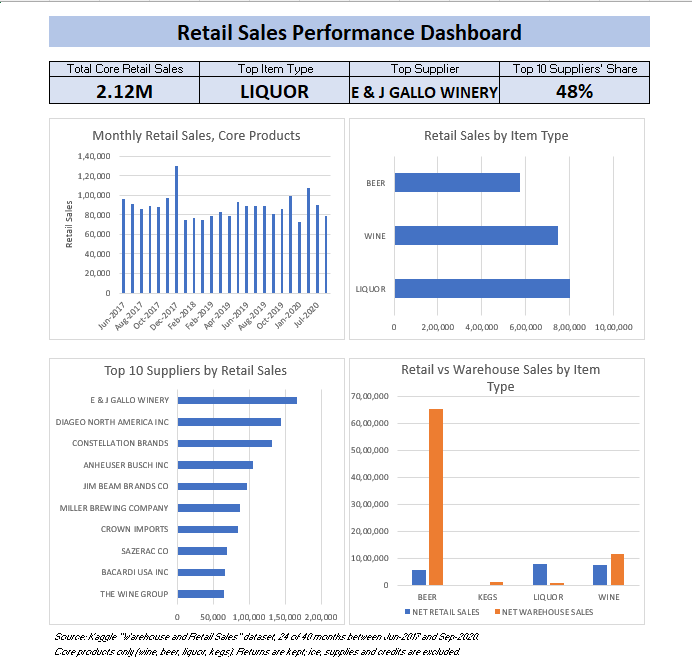

# Retail Sales Performance Analysis

An Excel analysis of retail and warehouse sales for a wine, beer and liquor distributor, covering data cleaning, pivot tables and an dashboard.

## Business Problem

A distributor wants to understand where its sales come from. Which products, suppliers and months matter most, how do the sales channels differ, and which items barely sell?

## Dataset

- **Source:** Kaggle, "Retail Sales Analysis" by Sahir Maharaj (Warehouse_and_Retail_Sales.csv)
- **Size:** about 300,000 rows, 9 columns (year, month, supplier, item code, item description, item type, retail sales, retail transfers, warehouse sales)
- **Period:** Jun-2017 to Sep-2020

## Tools Used

Microsoft Excel: Tables, formulas, PivotTables, PivotCharts, dashboard design.

## Questions Answered

1. How do retail sales change month by month, and is there seasonality?
2. Which item types bring the most retail sales?
3. Which suppliers drive the most sales?
4. How do retail sales compare with warehouse sales?
5. Which items sell the most, and which are slow movers?

## Data Cleaning

- Filled blank **SUPPLIER** values with "No Supplier" (these were store items such as glassware and ice, not missing sales).
- Fixed one blank **ITEM TYPE** (a Barolo wine) so it was not dropped from the analysis.
- Added a **SALES GROUP** column: Core Product (wine, beer, liquor, kegs) vs Exclude.
- Excluded non-product items: ice and other non-alcohol items, store supplies, empty kegs (dunnage) and accounting credits. These were about 1.7% of total sales and would have distorted the results.
- Kept small negative retail sales values, since they are returns and keep net sales accurate.
- Added a **DATE** column (first day of each month) for monthly trends.

## Key Insights

1. **Seasonality:** December 2017 was the peak at about 129,800, roughly 34% above November, consistent with holiday demand. January was the lowest month in each year's available data (2018, 2019 and 2020).
2. **Item types:** Liquor leads with about 802,700 (38% of core retail sales), then wine at 746,500 (35%) and beer at 574,200 (27%).
3. **Suppliers:** The top 10 suppliers generated about 1,014,300, roughly 48% of core retail sales. E & J Gallo Winery is first (about 166,200), followed by Diageo North America and Constellation Brands. The top 3 account for about 21%.
4. **Channels:** Beer sells mostly through the warehouse (about 6.5 million vs 574,000 retail), liquor mostly through retail (about 802,700 vs 94,900 warehouse), and wine is more balanced. Kegs sell only through the warehouse.
5. **Top items:** Tito's Handmade Vodka 1.75L is the best seller (about 27,600), followed by Corona Extra and Heineken. Seven of the top 10 items are beers. The top 10 items make up only about 7% of sales, so sales are spread across a long tail of products.
6. **Slow movers:** 4,655 items had total retail sales between 1 and 10, together under 1% of core retail sales (about 19,200).

## Recommendations

- Prioritize inventory and relationships with the largest suppliers, since 10 suppliers drive nearly half of sales.
- Plan stock and promotions for the December peak, and expect a January slowdown.
- Review the slow-moving items for clearance, delisting or smaller orders, after checking whether they are new or seasonal launches.
- Treat beer and liquor as different businesses: beer is driven by bulk warehouse sales, liquor by retail shoppers.

## Limitations

- The dataset has only **24 of the 40 months** between Jun-2017 and Sep-2020, so year-over-year comparisons are not reliable (2018 has only 2 months).
- Warehouse and retail figures may use different units, so the channel comparison looks at patterns by category, not overall totals.
- "Slow mover" is defined as total retail sales between 1 and 10. This threshold is a judgment call.

## Files

- `dashboard.png`: dashboard screenshot
- `retail_sales_working.xlsx`: full workbook (cleaned data, pivot tables, dashboard)

## About Me

Baladharshini | Aspiring Data Analyst | Excel, SQL, Power BI
LinkedIn: https://www.linkedin.com/in/baladharshini-s-00420b269
